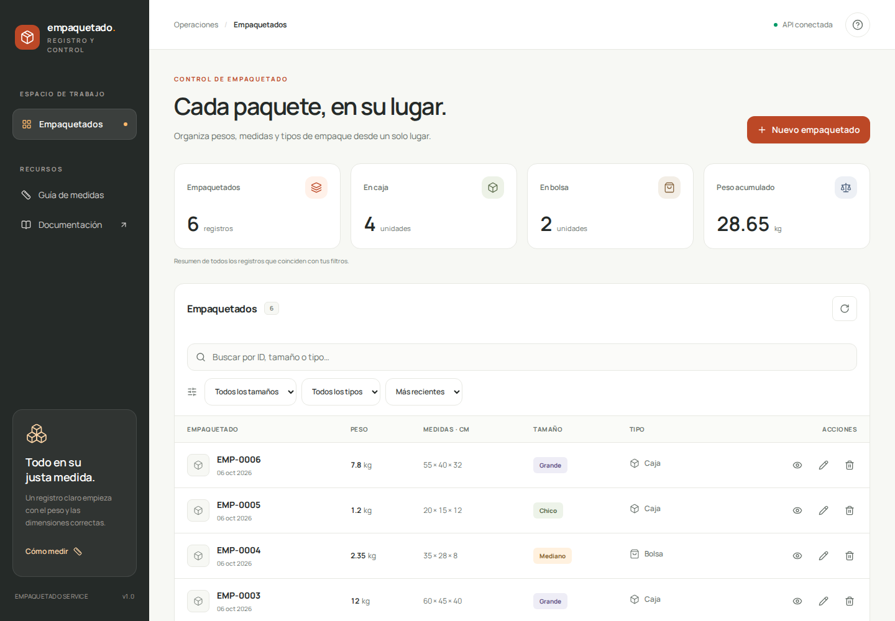
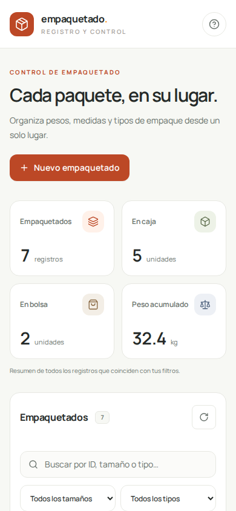
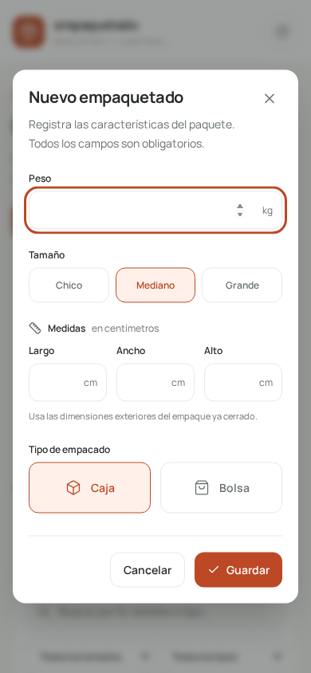

# Verificación de la entrega

Fecha: 6 de octubre de 2026 (UTC).

Entorno comprobado: Linux, Node.js **24.19.0**, npm **11.9.0**, Chromium **153**. Los scripts de instalación y arranque utilizan npm y Node, sin depender de comandos exclusivos de Bash. No se declara una ejecución local en Windows o macOS.

## Resultados

| Comprobación                                  | Resultado                                                           |
| --------------------------------------------- | ------------------------------------------------------------------- |
| Instalación de dependencias                   | Correcta; versiones fijadas con lockfile                            |
| TypeScript de API, frontend y E2E             | Sin errores                                                         |
| ESLint de API y frontend                      | Sin errores ni advertencias                                         |
| Vitest                                        | **49 pruebas aprobadas**, 3 archivos                                |
| Playwright                                    | **12 pruebas aprobadas**, escritorio y móvil                        |
| Build de API                                  | Correcto, generado con TypeScript                                   |
| Build de frontend                             | Correcto, Next.js 16.3.8 con Turbopack                              |
| Ejecución de builds mediante `npm start`      | Correcta                                                            |
| Comunicación real frontend/API                | Alta desde formulario y recuperación después de recargar, correctas |
| Swagger en navegador                          | Interfaz cargada con las 6 operaciones documentadas                 |
| OpenAPI                                       | Especificación **3.0.3** validada mediante Swagger Parser           |
| Errores JavaScript en recorrido de producción | Ninguno detectado                                                   |
| Persistencia                                  | Registro conservado después de cerrar y reconstruir la API          |
| Migraciones                                   | Aplicación inicial y repetición sin duplicados verificadas          |
| Adaptación a pantallas                        | Sin desbordamiento horizontal en 320, 390, 768, 1024 y 1440 px      |

## Alcance de Vitest

Las pruebas utilizan solicitudes Fastify `inject` sobre la aplicación real y archivos SQLite temporales. No reemplazan la persistencia por arrays.

- Creación con `201`, encabezado `Location`, fechas y representación de medidas.
- Listado vacío, búsqueda por ID visible, búsqueda textual y escape de comodines/SQL.
- Filtros, ordenamiento, paginación y totales coherentes con todos los resultados.
- Consulta por ID y manejo de registros inexistentes en GET, PATCH y DELETE.
- Actualización de una dimensión sin perder las demás; conservación de `createdAt`.
- Versiones monótonas y rechazo `409` de ediciones o eliminaciones obsoletas.
- Eliminación `204` sin cuerpo y consulta posterior `404`.
- Peso, tamaño, tipo y dimensiones inválidos; campos faltantes o desconocidos.
- IDs y parámetros de consulta inválidos; PATCH vacío; JSON mal formado y tipo de contenido incorrecto.
- Persistencia después de reiniciar, restricciones SQL, CORS y estado de salud.
- Error real de SQLite sin filtrar consultas o stack traces al cliente.
- Swagger, componentes, especificación válida y respuesta `204` documentada sin contenido.

## Alcance de Playwright

Se ejecutan seis escenarios en cada perfil de navegador:

1. Alta con validaciones, consulta, edición, cancelación de borrado y eliminación confirmada.
2. Búsqueda, filtros, ordenamiento y paginación con datos insertados mediante HTTP.
3. Conflicto de edición frente a un cambio realizado por otro cliente.
4. Error de conexión y recuperación después de volver a habilitar la API.
5. Anchos de pantalla y formulario sin desbordamiento horizontal.
6. Foco inicial, navegación de teclado dentro del diálogo, Escape y retorno al control que lo abrió.

El caso de desconexión bloquea intencionalmente la solicitud desde el navegador para verificar el estado de error. El resto de recorridos utiliza la API y base reales. Los datos E2E se aíslan en un archivo temporal y se eliminan al terminar.

La infraestructura de esta revisión utilizó un ejecutable de Chromium instalado a través de un paquete de herramientas, indicado mediante `PLAYWRIGHT_CHROMIUM_EXECUTABLE_PATH`. Ese ejecutable no se incluye en el ZIP. En una instalación habitual, prepara el navegador con `npx playwright install chromium`.

## Revisión visual del build

Las capturas siguientes corresponden al frontend ejecutado desde el build de producción. Se cargaron los seis registros opcionales de demostración y se creó un séptimo para verificar persistencia tras recargar. La base de datos utilizada para estas capturas no forma parte de la entrega.

### Escritorio

### Teléfono

### Formulario

## Límites de lo verificado

No se ejecutó una prueba de carga ni una auditoría completa de accesibilidad. Los perfiles de escritorio y móvil utilizan Chromium; no se declara cobertura de Safari o Firefox. Los ejemplos de integración con otros lenguajes son documentación, no ejecuciones verificadas de sus compiladores.

La entrega no contiene datos de pruebas, contraseñas, dependencias instaladas ni builds específicos de esta máquina. El procedimiento de instalación y los comandos para reproducir las verificaciones están en el README principal.
